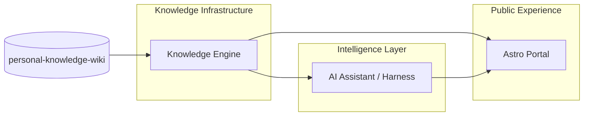

# Personal Tech Hub V2.0 — AI-Native Knowledge Platform

> **关联文档：** [desgin.md](./desgin.md)（V1 门户架构与内容模型）  
> **文档性质：** 产品与技术蓝图（整理版），供分阶段实施与工程拆解参考。

---

## 摘要

**Personal Tech Hub V2.0** 不是「V1 页面 + 聊天机器人」，而是：

```text
Personal Tech Hub V2.0
  = Personal Knowledge Infrastructure
  + AI Knowledge Assistant
  + Engineering Portfolio
```

目标：持续**摄取 → 理解 → 关联 → 研究 → 通过 Agent 使用**个人知识，而不只是展示能力。

**V2.0 优先建设方向（不是普通 RAG 问答）：**

1. `personal-knowledge-wiki` 为**唯一知识源**（权威 Markdown）。
2. 统一**知识处理与索引流水线**（可增量、可重建）。
3. **Knowledge Graph** 表达结构关系（PostgreSQL 起步）。
4. **Agent Harness、Skills、MCP** 提供可审计的智能能力。
5. **Projects / Case Studies / Blog / Skills** 等在 Portal 统一呈现。
6. **Astro 静态门户** + **独立 AI Backend**（Python / FastAPI）。

**分工原则：**

| 组件 | 职责 |
| ---- | ---- |
| Wiki | 内容 |
| Knowledge Engine | 理解、索引、检索、关系 |
| Agent Runtime | 规划、工具、记忆、执行 |
| Portal | 交互与展示 |

---

## 目录

1. [产品形态：三大协作系统](#一产品形态三大协作系统)
2. [总体技术架构](#二总体技术架构)
3. [三仓库设计](#三三仓库设计)
4. [Knowledge Engine（核心）](#四knowledge-enginev20-的核心)
5. [RAG + GraphRAG](#五rag--graphrag)
6. [Agent Platform](#六agent-platform)
7. [MCP + Skills](#七mcp--skills)
8. [前端产品设计](#八前端产品设计)
9. [技术选型](#九技术选型)
10. [数据安全与权限](#十数据安全与权限)
11. [工程目录（Engine 仓库）](#十一工程目录)
12. [部署架构](#十二部署架构)
13. [实施路线（M1–M4）](#十三实施路线)
14. [最终功能清单](#十四最终功能清单)
15. [推荐技术决策](#十五推荐技术决策)
16. [最终产品形态与优先级](#十六最终产品形态与优先级)

---

## 一、产品形态：三大协作系统

三个系统**可独立演进**，不必一开始就拆成大量微服务。

### 01 · Public Experience — Personal Tech Hub

面向访问者的个人技术门户。

**能力：** Projects · Case Studies · Blog · Knowledge · Notes · Skills · Graph · **Ask My Knowledge**（克制入口）

### 02 · Knowledge Infrastructure — Personal Knowledge Engine

面向知识的处理、索引、检索与关系管理。

**能力：** Ingestion · Parsing · Metadata · Vector Search · Graph · Full-text Search

### 03 · Intelligence Layer — Personal AI Assistant

面向研究、问答、知识整理与自动化。

**能力：** Agent Runtime · Harness · Skills · MCP · RAG · Research Workflow

### 职责边界

| 系统 | 核心职责 | 是否公开 |
| ---- | -------- | -------- |
| Tech Hub | 品牌、项目、知识浏览 | 公开 |
| Knowledge Engine | 处理、检索、知识关系 | 内部为主 |
| AI Assistant | 问答、研究、整理、工具调用 | 选择性开放 |



---

## 二、总体技术架构

**模式：** 静态门户 + 模块化知识后端 + Agent Runtime。

### 分层概览

| 层级 | 组件 | 技术 |
| ---- | ---- | ---- |
| **Experience** | Portfolio、Knowledge Explorer、AI Chat、Research Workspace、Admin、Skill Library | Astro · React Islands · TS |
| **接入** | REST API · SSE · MCP | — |
| **Application & Intelligence** | API Gateway / Auth、Agent Harness、RAG Orchestrator、Research / Knowledge Agent、Workflow | Python · FastAPI · LangGraph · MCP · Skills |
| **Knowledge Engine** | Ingestion、Metadata Registry、Hybrid Retrieval、Graph、Embedding、Search Index | — |
| **Data & Storage** | Wiki Markdown、PostgreSQL、Qdrant、Neo4j（可选）、Object Storage、Redis | — |
| **External** | GitHub、MCP Servers、LLM Providers、外部调研源 | — |

### 重要原则：单一内容源，多种索引表示

**不要把 Wiki、向量库、知识图谱当成三个平行内容源。**

它们是**同一份知识的不同表示**，且**派生索引必须能从 Wiki 全量重建**：

| 表示 | 作用 |
| ---- | ---- |
| Markdown（Wiki） | 原始知识、权威版本 |
| PostgreSQL | 结构化元数据、关系、运行状态 |
| Qdrant | 语义检索 |
| Knowledge Graph | 实体与关系 |
| Search Index | 全文检索 |

---

## 三、三仓库设计

V1.x 两仓库足够支撑静态站；V2.0 **建议增加第三个仓库**。

### 01 · `personal-knowledge-wiki` — 唯一内容源

- Blog / Notes / Knowledge
- Projects / Case Studies
- Skills / Prompts
- Taxonomy / Metadata
- Images / Attachments

### 02 · `boyang167.github.io`（`personal-tech-portal`）— 展示门户

- Astro 站点、Portfolio
- Knowledge Explorer
- AI Chat 入口、Research Workspace（React 岛）

### 03 · `personal-knowledge-engine` — 新增（建议）

- Content Ingestion、RAG / GraphRAG
- Agent Harness、MCP Server
- API、Background Workers
- Evaluation / Observability

### 为何分离 Portal 与 Engine？

| 维度 | Portal | Knowledge Engine |
| ---- | ------ | ---------------- |
| 运行模式 | 静态构建 | 长期运行服务 |
| 技术栈 | Astro / TypeScript | Python / FastAPI |
| 部署 | GitHub Pages | Docker / Cloud |
| 数据 | 构建时内容索引 | PostgreSQL / Qdrant |
| 职责 | 展示与交互 | 检索、推理、执行 |

避免在静态站点中部署 Python、数据库连接与 LLM API Key。

---

## 四、Knowledge Engine（V2.0 的核心）

### 4.1 内容处理流水线

Wiki 更新后应走**可追踪**的处理流程，而非简单复制 Markdown。

```text
Source (GitHub Wiki · MD · YAML · Images)
    → Ingestion (Webhook · Commit · File Discovery)
    → Parsing & Normalization (Parser · Frontmatter · Chunking · Metadata)
    → Structured Index (PostgreSQL: Document / Tags / Relations / Version)
    → Semantic Index (Qdrant: Chunks / Embeddings / Metadata)
    → Graph Index (Entities / Relationships / Topics)
    → Full-text Index (Keywords / Titles / Content)
    → Unified Knowledge API
```

**增量处理（推荐）：**

| 事件 | 动作 |
| ---- | ---- |
| 新增文件 | 解析、切片、Embedding、建关系 |
| 修改文件 | 仅重建受影响索引 |
| 删除文件 | 删除向量、关系、搜索记录 |
| Frontmatter 变更 | 重算关系与元数据 |
| Wiki commit 变化 | 记录版本，保证索引最终一致 |

### 4.2 知识模型

不要把所有 Markdown 扁平化为单一 Document。建议统一对象：

```python
class KnowledgeDocument:
    id: str
    title: str
    content: str
    document_type: str
    category: str
    tags: list[str]
    source_repo: str
    source_path: str
    source_commit: str
    visibility: str
    created_at: datetime
    updated_at: datetime
    relations: list["KnowledgeRelation"]


class KnowledgeRelation:
    source_id: str
    target_id: str
    relation_type: str
    confidence: float
```

**关键属性：**

- `visibility`：`public` / `private`（及扩展等级，见第十章）。
- `source_commit`：回答与引用可追溯到具体 Wiki 版本。

### 4.3 Chunking：按语义结构，非固定长度

| 内容类型 | 切片策略 |
| -------- | -------- |
| Blog | 按 Heading |
| Notes | 主题 + 段落 |
| Technical Documentation | Heading + Code Block |
| Projects | 项目章节 |
| Skills | Skill Instruction 结构 |
| Case Studies | 问题 / 方案 / 结果 |

**每个 Chunk 元数据：** `document_id`、`heading_path`、`chunk_index`、`source_path`、`source_commit`、`visibility`、`token_count`。

---

## 五、RAG + GraphRAG

V2.0 **不应只做向量检索**。典型跨文档问题：

- Agent Harness 与 MCP 的关系？
- 哪些项目用过 LangGraph？
- 研究过哪些 Data Agent？
- 某项目关联的案例与 Skills？
- 对比不同文章中 Agent Architecture 的表述？

需要 **语义 + 关键词 + 关系** 混合检索。

### 5.1 混合检索流程

```text
User Query
  → Query Understanding（意图 · 实体 · 改写）
  → 并行：Vector (Qdrant) | Keyword (FTS) | Graph (Relations)
  → Fusion & Reranking（去重 · 排序 · 权限 · 证据筛选）
  → Grounded Answer + Citations
```

### 5.2 技术选型建议

| 能力 | 推荐 |
| ---- | ---- |
| Vector | Qdrant |
| Metadata | PostgreSQL |
| Keyword | PostgreSQL FTS / Pagefind（门户侧） |
| Graph | **PostgreSQL relations 起步**，复杂后再 Neo4j |
| Reranking | Cross-Encoder / Reranker API |
| Embedding | 可替换 Provider |
| Orchestration | 自研轻量检索层 + LangGraph |

**建议：** 先不要上 Neo4j；递归查询与关系表可满足大部分图谱需求，直到多跳路径、图算法成为明确瓶颈。

---

## 六、Agent Platform

AI Assistant 不应只有一个 Chat 接口；**多 Agent 能力 + 共享 Agent Harness**。

### 6.1 架构分层

```text
Personal AI Assistant（对话 / 任务 / 用户上下文）
        ↓
Agent Harness（Context · Planning · Tool · Memory · State · Guardrails）
        ↓
Agents: Knowledge | Research | Writing | Curator | Project | Skill
        ↓
MCP Tools + Skills + Knowledge APIs
```

### 6.2 第一批 Agent（建议先 3 个）

| Agent | 能力 | 典型场景 |
| ----- | ---- | -------- |
| **Knowledge Agent** | 检索、总结、关联 | 回答历史研究问题 |
| **Research Agent** | 多轮调研、核验来源 | 调研开源项目 |
| Writing Agent | 结构、草稿 | 笔记 → 文章 |
| Knowledge Curator | 标签、关系、分类建议 | 整理新笔记 |
| Project Agent | 项目文档分析 | 项目总结 |
| Skill Agent | 发现、加载、执行 Skill | 技术工作流 |

**MVP：** Knowledge Agent、Research Agent、Knowledge Curator。

### 6.3 Agent Harness 目录（模块化单体）

```text
agent_runtime/
├── core/          # agent, execution, context, state, lifecycle
├── harness/       # planner, tool_executor, memory, context, guardrails, human_approval
├── agents/        # knowledge, research, writing, curator, ...
├── tools/         # knowledge_search, graph_query, github_search, document_reader
└── adapters/      # langgraph, mcp, llm
```

**原则：**

- Harness：生命周期、上下文、权限、工具调用。
- LangGraph：复杂流程与状态图。
- MCP：外部工具协议。
- Skills：可复用任务方法。
- LLM：统一接口，可切换供应商。

参考生态（DB-GPT、LangGraph、DeerFlow、Vercel AI SDK、ORCA、Multica 等）通过 **Adapter** 接入，**不绑定单一框架为唯一运行时**。

---

## 七、MCP + Skills

将 Knowledge Engine 能力封装为 **MCP Server**，供 Codex、Claude Code、ChatGPT 等（授权后）调用。

### 7.1 MCP Tools（首批）

| Tool | 功能 |
| ---- | ---- |
| `search_knowledge` | 搜索知识库 |
| `get_document` | 读取文档 |
| `get_related_content` | 关联内容 |
| `query_knowledge_graph` | 关系查询 |
| `search_projects` | 项目搜索 |
| `search_skills` | Skills 查找 |
| `create_knowledge_draft` | 知识草稿 |
| `update_metadata` | 更新元数据 |

**Resources（示例）：** `knowledge://topics` · `projects` · `skills` · `recent`  
**Prompts：** 研究、写作、知识整理模板。

### 7.2 Skills 双轨

| 类型 | 说明 |
| ---- | ---- |
| Wiki Skills | 知识资产：版本、展示 |
| Runtime Skills | 校验、授权、白名单后由 Agent 执行 |

```text
skills/
├── knowledge-research/SKILL.md
├── technical-writing/SKILL.md
├── code-analysis/SKILL.md
├── ml-experiment-analysis/SKILL.md
└── knowledge-curation/SKILL.md
```

**禁止：** Agent 自动执行 Wiki 中任意指令；加载需来源校验、权限检查、工具白名单。

---

## 八、前端产品设计

**双层体验：** 公开门户 + 个人工作空间。

### 8.1 Public Portal

保留：Home · About · Projects · Case Studies · Blog · Knowledge · Notes · Skills · Graph  
增加克制入口：**Ask My Knowledge**。

### 8.2 AI Knowledge Workspace（`/workspace`）

**布局概念：**

| 区域 | 内容 |
| ---- | ---- |
| Sidebar | New Conversation · Knowledge Search · Graph · Projects |
| Main | 对话与任务 |
| Panel | Retrieved Sources（可点击 Wiki 原文） |

**示例提示：** *How are Agent Harness, MCP and Skills connected in my notes?*

| 功能 | 说明 |
| ---- | ---- |
| AI Chat | 多轮问答 |
| Source Panel | 引用来源 |
| Knowledge Explorer | 结果与关系浏览 |
| Research Mode | 深度调研报告 |
| Writing Mode | 文章草稿 |
| History | 对话与研究记录 |
| Agent Selection | 选择 Agent |

**传输：** 对话优先 **SSE 流式**；需双向实时事件再考虑 WebSocket。

### 8.3 回答 = 可追溯知识结果

每条回答尽量包含：**结论 · 证据文档 · 原文章节 · 知识关系 · 相关项目 · 相关 Skills · 来源版本**。

---

## 九、技术选型

| 层次 | 推荐 | 理由 |
| ---- | ---- | ---- |
| Public Frontend | Astro | 高性能静态门户 |
| Workspace UI | React + TS | 复杂交互 |
| API Backend | FastAPI | Python / AI 生态 |
| Agent Orchestration | LangGraph | 状态化多步任务 |
| Agent Harness | 自研轻量核心 | 生命周期、权限 |
| LLM Gateway | LiteLLM | 供应商抽象 |
| Embedding | 可替换 Provider | 避免锁定 |
| Vector DB | Qdrant | 语义检索 |
| Metadata DB | PostgreSQL | 文档、权限、关系 |
| Graph | PostgreSQL 起步 | 控制运维成本 |
| Cache / Queue | Redis | 缓存、任务 |
| MCP | MCP Python SDK | 互操作 |
| Observability | Langfuse | Trace、成本、质量 |
| Validation | Pydantic + Zod | 前后端校验 |
| Deployment | Docker | 后端统一 |

### 关键取舍（不建议 V2.0 初期）

1. **不**用 Next.js 替换 Astro（门户仍 Astro，Workspace 用 React 岛）。
2. **不**并行以 LangGraph、DeerFlow、DB-GPT、Vercel AI SDK 均为核心运行时。
3. **不**先上 Neo4j / Kubernetes。
4. **不**以向量库为唯一内容备份（Markdown 始终权威）。

---

## 十、数据安全与权限

Wiki 中可能同时存在：公开博客、私人笔记、未公开项目、内部 Skills、企业敏感信息。**不能整库同步到公开 AI。**

### 内容对象建议字段

```yaml
visibility: public          # public | private | restricted
ai_indexing: true
allow_external_llm: true
```

### 权限等级

| 级别 | Portal 展示 | AI 检索 | 外部 LLM |
| ---- | ----------- | ------- | -------- |
| Public | 允许 | 允许 | 按用户授权 |
| Private | 不允许 | 允许（内部） | 默认禁止 |
| Restricted | 不允许 | 默认禁止 | 禁止 |

**默认规则：** 未明确公开的内容，**不进入公开索引**。

### 安全清单

- GitHub Token / LLM Key 仅服务端。
- MCP 最小权限；写 Wiki 需审批。
- 外部网页视为不可信输入。
- 高风险操作 Human-in-the-loop。
- 私有回答不可通过公开链接或缓存泄露。

---

## 十一、工程目录

`personal-knowledge-engine` 建议 **模块化单体**：

```text
personal-knowledge-engine/
├── apps/
│   ├── api/              # main.py, routes: knowledge, search, chat, graph, skills
│   ├── worker/           # ingestion_worker, embedding_worker
│   └── mcp_server/
├── packages/
│   ├── knowledge/        # parser, chunker, metadata, relationships
│   ├── retrieval/        # vector, keyword, graph, fusion, reranker
│   ├── agents/           # harness, runtime, context, memory, agents
│   ├── skills/, mcp/, llm/, observability/
├── migrations/, tests/, scripts/, docker/, config/
└── pyproject.toml
```

Portal：沿用 Astro 结构，新增 `/workspace` 与 React 交互组件。

---

## 十二、部署架构

```text
GitHub (Wiki · Portal · Engine)
    → GitHub Actions (CI · 内容校验 · Build · Deploy)
    → GitHub Pages (Astro 公开门户)
    → Docker Host (FastAPI + Agent + MCP)
    → 私有网络: PostgreSQL · Qdrant · Redis · Object Storage
```

### 域名规划（示例）

| 域名 | 功能 |
| ---- | ---- |
| `boyang167.github.io` | 公开门户 |
| `api.your-domain.com` | Knowledge API |
| `ai.your-domain.com` | AI Workspace |
| `mcp.your-domain.com` | 远程 MCP（按需） |

无自有域名时可用云主机或受控隧道；**勿将 PG / Qdrant / Redis 直接暴露公网**。

---

## 十三、实施路线

**一个 V2.0 产品目标，四个工程里程碑。**

### M1 · Knowledge Foundation（P0）

- [ ] Wiki 内容 Schema
- [ ] Content Ingestion Pipeline
- [ ] Metadata Registry
- [ ] PostgreSQL 文档索引
- [ ] Qdrant 向量索引
- [ ] 增量更新与删除
- [ ] Public / Private 隔离

**验收：** Wiki 变更后可自动同步并重建索引。

### M2 · AI Knowledge Assistant（P0）

- [ ] Hybrid Retrieval · RAG · Reranking
- [ ] Citation / Source Trace
- [ ] Knowledge Agent
- [ ] AI Workspace · SSE Streaming

**验收：** 跨文档问答准确，且引用原始知识。

### M3 · Agent & Knowledge Graph（P1）

- [ ] Knowledge Graph · Graph Retrieval
- [ ] Agent Harness
- [ ] Research Agent · Knowledge Curator
- [ ] Skills Runtime · MCP Server

**验收：** 有证据、有审批的多步骤任务可执行。

### M4 · Personal Tech Hub Integration（P1）

- [ ] Portfolio V2.0 · Knowledge Explorer
- [ ] AI 入口 · Project / Case Study 关联
- [ ] Skills Library · 搜索与图谱交互
- [ ] SEO / Performance / Security

**验收：** 公开站与 Workspace 共用同一知识基础设施。

### 质量评估体系（从第一版建立）

| 维度 | 指标 |
| ---- | ---- |
| 检索 | Recall@K、Precision@K、MRR |
| 回答 | Faithfulness、Answer Relevance |
| 引用 | Citation Precision / Coverage |
| Agent | Task Success、Tool Success |
| 性能 | Latency、Token Usage |
| 成本 | Cost per Query / Task |
| 同步 | Index Freshness、Sync Failure Rate |

**初始测试集：** 手动准备 50～100 个真实问题（Harness 设计、GraphRAG 文章、ML 验证策略、LangGraph 对比、项目关联文章等）。每次改 Chunking / Embedding / Rerank / Prompt 都跑评估集。

---

## 十四、最终功能清单

### 01 · Portfolio（Public）

Home · About · Projects · Case Studies · Blog · Knowledge · Notes · Skills · Graph

### 02 · Knowledge Platform（Core）

Ingestion · Metadata · Hybrid Search · Vector · Graph · Version · Validation · Access Control

### 03 · AI Assistant（Intelligence）

Knowledge / Research / Writing / Curator Agent · RAG / GraphRAG · Harness · Skills Runtime · MCP

### 04 · Engineering Operations

CI/CD · Observability · Evaluation · Model Gateway · Security · Backup · Cost · Automated Testing

---

## 十五、推荐技术决策

| 决策 | 建议 |
| ---- | ---- |
| 内容源 | GitHub Wiki（唯一权威） |
| 前端 | Astro + React |
| 后端 | FastAPI |
| 数据库 | PostgreSQL |
| 向量 | Qdrant |
| 图关系 | PostgreSQL → 按需 Neo4j |
| Agent | 自研 Harness + LangGraph |
| 模型 | LiteLLM |
| MCP | 独立 MCP Server |
| Skills | Markdown + Runtime Loader |
| 任务 | Redis Queue / Worker |
| 可观测 | Langfuse |
| 部署 | Docker Compose |
| 发布 | GitHub Actions |

### V2.0 初期刻意不引入

Kubernetes · 微服务拆分 · 多租户 SaaS · 复杂权限中心 · Neo4j+Qdrant+ES 三套检索 · 多并行 Agent 编排框架 · **未经人工审核的自动发布**

---

## 十六、最终产品形态与优先级

**对外：** 技术能力 · 项目与案例 · 文章与知识 · 公开知识上的 AI 探索  

**对内：** 知识整理 · 历史检索 · 方案对比 · 报告与草稿 · Skills / MCP · 个人知识图谱  

这不是 Blog，而是 **Personal AI Platform**。

### 技术核心（可沉淀为独立产品）

```text
Personal Knowledge Engine
  + Agent Harness
  + MCP
  + Skills
  + Knowledge Graph
```

### 投入优先级（关键建议）

**优先不是 AI Chat UI，而是：**

1. **Knowledge Engine**
2. **Agent Harness**
3. **评估体系**
4. **可靠知识关系（Graph 能力）**

原因简述：

- 无 Engine → AI 只是聊天机器人。
- 无关系 → GraphRAG 徒增复杂度。
- 无 Harness → Skills / MCP 只是散工具。
- 无评估 → 无法持续迭代。

---

## 附录 A · 下一步工程化

建议将本蓝图进一步拆为 **V2.0 工程包**（可直接交给 Codex / Agent 实施）：

- 三仓库完整目录与边界
- 数据库 Schema（Document / Chunk / Relation / Job）
- API Contract（OpenAPI）
- Agent Harness 接口与状态机
- 部署拓扑与 Docker Compose
- M1–M4 任务分解与验收脚本

---

*文档整理说明：统一标题层级与表格；架构与流水线改为代码块 / Mermaid；移除无效占位链接；保留原方案决策与里程碑内容。*
